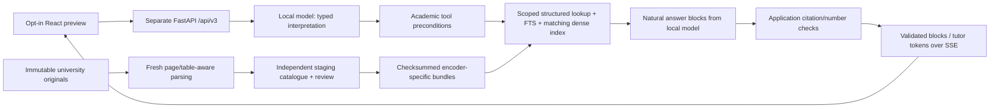

# QAU chatbot replacement: working preview, quality gate still open

The isolated timetable upload, review, versioned publication/rollback and SQL query feature is documented in [TIMETABLE_V3.md](TIMETABLE_V3.md). The real Spring 2026 PDF remains an unpublished draft awaiting administrator review; its addition does not close the chatbot's independent quality gate.

The replacement runs beside the original chatbot. **The rebuild is not complete or approved for production.** The requested Qwen 3.5 generator and Qwen embedding/reranker comparisons await downloads, and the user will independently review the benchmark. Engineering tests and successful HTTP requests do not establish factual accuracy.

The latest [quality recovery evidence](CHATBOT_V3_RECOVERY.md) includes a fresh thirty-case comparison, twenty actual student conversations, extraction and grounding repairs, and remaining blockers. The user's review export exists but its path is still needed. Earlier results below are retained historical trials.

Open the preview at <http://127.0.0.1:5180>. The original frontend/API remain on their existing ports. No existing chatbot component, university original, PostgreSQL table, volume or production route has been removed or switched.

## Evidence and current results

- Branch: `rebuild/qau-chat-v3-20261011`. Existing uncommitted work was preserved.
- Backup: `.runtime/backups/chatbot-rebuild-20261011/`. All 2,036 archived files were checksummed, extracted and checked again. A PostgreSQL dump was restored into the separate local database `qau_chat_v3_restore_20261011`; all 32 base-table row counts match. The restore-test database is retained.
- All 425 assets from the initial inventory retain their original checksums.
- Thirty real old-chatbot trials were recorded before implementation. Twenty-four traces have engineering observations of defects; these observations are not independently reviewed accuracy labels.
- Thirty paired replacement trials ran on **interim `qwen3:8b`**, with 29 HTTP completions and one queue timeout during simultaneous browser testing. Raw answers include failures and are retained. The latency summary uses a documented nearest-rank percentile calculation; consult the machine-readable report for current values.
- A real Chromium three-turn conversation passed: binary-search explanation, Python follow-up, then a Roman Urdu Fall 2024 curriculum question with a source view. The earlier queue-timeout browser failure is retained too.
- The final Chromium run passed two tests, including that conversation, cancellation and the mobile composer. A real three-request capacity trial returned 200/200/503 in 13.46 s / 21.44 s / 90 ms. This verifies the prototype's configured admission limit, not production throughput.
- Twenty-four focused backend checks and twelve frontend checks passed. They cover transport, provenance boundaries, original PDF layouts, isolation, ownership, cancellation and the release gate, not student answer correctness.
- A second thirty-case run completed 27 responses; three hit the interim model's output budget. Median latency was 18.5 s, p95 91.6 s, and median first token 14.4 s. This run still contains faculty relevance, language and admissions failures. The subsequent focused run produced complete eight-semester and degree-credit comparison answers, but recorded two temporary local-model errors. Every raw run is retained; the workbench uses the latest available result per case rather than hiding failures.
- The review workbench contains **242 pending reference conversations**. Earlier AI source checks remain draft labels. No independently approved factual-accuracy result exists yet.
- The separate academic extraction queue contains 96 source versions. The Qwen generator and search-model downloads have experienced connection resets, timeouts and network route failures; bounded resumable retry scripts are available. The stronger-model selection is still unmeasured.

Known answer failures remain: faculty answers can add unsupported related interests, Urdu generation can exhaust its output budget, admissions answers are incomplete while evidence review is pending, and automatic language selection has failed. The response contract now separates an explicitly requested reply language from the message language. These defects block release; neither the unit tests nor the browser checks certify student answer quality.

The final explicit-language replay correctly interpreted `roman_urdu`, but the interim generator still answered in English and added an unbacked `[1]` marker. Its HTTP 200 is recorded as a transport completion, not a successful student answer. This is a concrete generator-quality blocker, not a passing regression.

The initial retrieved source library had 633 passages / 35 identities. Fresh digital extraction parsed 384 inputs, recorded four digital failures and fourteen exclusions, and produced 1,000 chunks. Selective OCR subsequently recovered the official 2021 scheme into three additional chunks in a separate version. OCR evidence is excluded from answers until human approval. Current staging has 385 source versions: 355 with recorded official origin and 30 unverified workspace sources. Workspace sources are excluded from factual retrieval. Source counts, original identities, versions and passages are different measures.

The bounded fresh crawl visited 13 URLs, discovered 146 including 133 pending URLs, parsed eight, recorded four failures and one 404. This is partial coverage, not a claim that every university page was crawled. Old acquisition archives remain intact.

## Exact inventory and retirement boundary

Read `.runtime/chatbot-v3/evaluation/inventory.json` for file hashes, imports, reverse imports, original assets and the canonical path. The original live path was verified as:

`frontend/src/main.jsx:Chat → backend/app/api/advisor.py → app/nlp/query_pipeline.py → app/rag/evidence.py → app/response/grounded.py`.

| Area | Treatment |
| --- | --- |
| Original `advisor.py`, query planner, generator, dedicated old chat APIs and dedicated retrieval tests | Retained for comparison; candidates for later retirement after approval and reverse-dependency review |
| `app/core/auth.py`, configuration/database helpers, academic/admin/CMS/timetable APIs, operational PostgreSQL tables | Shared and preserved; the replacement uses the existing authentication boundary |
| `app/rag/corpus.py`, `app/nlp/classifier.py`, `app/nlp/transformer.py` | Also reachable from shared routes; preserve or introduce compatible adapters before any retirement |
| `frontend/src/main.jsx`, site CSS, navigation, login, study plan, fees, timetable, policies and admin screens | Shared and preserved; only two opt-in preview integration lines were added to the existing entry point |
| PDFs, DOCX files, crawl originals/catalogue, collected HTML, academic-data and earlier corpus/index bundles | Preserved as input/rollback assets |
| `backend/chatbot_v3/`, `frontend/src/rebuild/`, separate preview/test configuration | New isolated implementation |
| `.runtime/chatbot-v3/` | New local catalogue, immutable index bundles, source acquisitions, evaluation/review artifacts and private runtime configuration |

Static imports cannot prove the absence of dynamic imports, external jobs or deployment consumers. This inventory grants no deletion permission. Before retirement, review the exact proposed files/tables with the user, verify restore again, and obtain explicit approval. Production cutover also requires separate approval. **Neither approval has been given.**

## Runtime and knowledge flow



The new path imports no legacy chatbot planner, retrieval normalizer, regex intent handler, answer templates or vectors. Structured interpretation uses a local-model adapter with validated contracts. Typed academic-tool preconditions require a programme for degree-specific rules and confirm ambiguous observed course identifiers; they operate after interpretation, without keyword routing. Each subquestion has its own scope. Document headings, layouts and codes use extraction patterns; those are not student intent handlers.

Parallel semester columns are reconstructed using word coordinates rather than the page midpoint. Full-width headers, internship notes and category totals remain separate from semester rows. Chunks preserve page, section, coordinates, checksum, source version, origin and review status. "Fall 2023 onwards" is stored as explicit applicability; a Fall 2024 request retains its own cohort. Published course lists never establish current offerings, teacher assignments or prerequisites.

The preview uses isolated SQLite migrations/FTS5 and a checksummed dense matrix. On this small dataset, temporary PostgreSQL FTS measured approximately 0.31 ms median versus 1.18 ms for SQLite, with different query semantics. Development PostgreSQL has no available pgvector extension; the E5 matrix is about 1.5 MB. This supports an isolated prototype, not a production scaling decision. Existing PostgreSQL auth and academic data remain untouched. Multi-worker production storage/session coordination is unfinished.

Grounded output uses complete natural answer blocks with separate source numbers. Application code resolves real document/page/version identifiers, checks numbers and emits validated blocks; conceptual tutoring streams native tokens. Whole-scheme lookup includes all semesters from one source version. A sum of all six printed credit categories is exposed as a deterministic calculation, separate from printed totals. High-stakes tool requests and policy/registration/fee/current-deadline/timetable/exam rules require approved evidence; OCR also requires approval. An intact official programme eligibility/test section can be described with pending extraction review, without certifying personal eligibility. An explicitly requested operational term cannot match an undated schedule. These checks establish provenance constraints, **not entailment or factual correctness**. Reviewed rules, source conflicts, completeness and useful language still need independent evaluation. No second call to the same model certifies every answer.

## Start, rebuild and replay

Run from the repository root using the installed environment, or install `backend/chatbot_v3/requirements.txt` into a separate environment. Do not upgrade the legacy environment in place. The requirements record versions inspected locally; a clean-container installation still needs validation.

```sh
# Free local candidates; these are large downloads.
ollama pull qwen3.5:9b
ollama pull qwen3.5:27b
# Bounded resumable retry, if direct pulls fail:
PYTHONPATH=backend backend/.venv/bin/python -m chatbot_v3.scripts.download_generators
PYTHONPATH=backend backend/.venv/bin/python -m chatbot_v3.scripts.download_search_models

# Edit backend/.env.v3: select ONE installed local model.
# Its private developer token is not committed. Template: backend/.env.v3.example.
PYTHONPATH=backend backend/.venv/bin/python -m chatbot_v3.ingest --workspace
PYTHONPATH=backend backend/.venv/bin/python -m chatbot_v3.scripts.ocr_missing
PYTHONPATH=backend backend/.venv/bin/python -m chatbot_v3.scripts.normalize_public
PYTHONPATH=backend backend/.venv/bin/python -m chatbot_v3.index --publish-preview
PYTHONPATH=backend backend/.venv/bin/python -m uvicorn chatbot_v3.api:app \
  --host 127.0.0.1 --port 8010 --timeout-graceful-shutdown 5

# Separate terminal, frontend/:
./node_modules/.bin/vite --config vite.rebuild.config.js

# One actual request with opt-in protected diagnostics:
PYTHONPATH=backend backend/.venv/bin/python -m chatbot_v3.scripts.replay \
  '5th sem ke subjects btado fall 2024 batch'
```

Changing the encoder, revision, prefixes, parser or corpus requires a new bundle. The manifest records model revision, encoding signature, sequence length, parser version, corpus/vector hashes and timestamp. An atomic pointer publishes only to the separate preview. Old bundles remain available. A routine crawl writes staging and never changes that pointer.

```sh
PYTHONPATH=backend backend/.venv/bin/python -m chatbot_v3.crawl \
  --max-pages 100 --max-seconds 300
PYTHONPATH=backend backend/.venv/bin/python -m chatbot_v3.scripts.review_source --list
```

Source review records require an explicit version, reviewer, decision and note. Restart the preview after CLI reviews; the protected API updates the running preview directly. Source review and benchmark answer review are separate operations. Approval of one does not imply the other.

## APIs and operational limits

The service exposes `/health/live`, `/health/ready`, and `/api/v3/chat`, `/chat/stream`, `/sources/{id}`, `/knowledge/coverage`, `/knowledge/review`, `/feedback`, `/history`, plus protected development traces and metrics. The last paths use the `/api/v3` prefix. SSE events are `start`, `status`, `token`, `citation`, `warning`, `done`, `error`. Grounded `token` events contain validated complete blocks; tutor events contain model text fragments. The browser handles arbitrary UTF-8 byte boundaries, stops generation, sanitizes Markdown, displays source snapshots and reports interrupted streams.

Only explicitly local Ollama URLs are accepted, cloud tags/remote models are rejected, and private student data is never silently sent to hosted inference. The crawler allows only the three configured official hosts, checks public DNS and redirects, robots rules, size/time bounds and incremental validators. Failed/private/unverified documents cannot silently become official evidence.

One model request is active per process. Admission and queue time are bounded; busy/model-down conditions return explicit errors rather than source excerpts posing as answers. Guest memory is owner-bound, ephemeral and bounded. Signed-in history uses the existing auth identity and a separate owner-scoped store with 90-day retention and explicit deletion. Feedback enters review, never automatic training. Developer traces default off and are bounded in memory when explicitly enabled. Signed-in/private-record free text is withheld from traces; guest diagnostics redact common emails, CNICs and phone identifiers. This pattern redaction cannot guarantee detection of every form of personal information, so enable diagnostics only for synthetic development questions. Use one worker for this prototype. HTTPS deployment, shared rate/session coordination and production capacity testing remain release work.

## Review and quality gate

Open `.runtime/chatbot-v3/evaluation/review.html`. It retains pending labels, links draft source quotes to originals, shows real paired responses and their captured evidence, and exports independently supplied references and human grades. Review assertions, applicability, actual source support, multipart completeness, language and usefulness. Earlier AI references are suggestions only. Held-out fact groups must remain separate from prompt/model tuning.

```sh
PYTHONPATH=backend backend/.venv/bin/python -m chatbot_v3.scripts.review_benchmark
PYTHONPATH=backend backend/.venv/bin/python -m chatbot_v3.scripts.live_evaluation \
  --cases /path/to/qau-v3-independent-review.json --approved-only --limit 242 \
  --output independently-labelled-replacement
PYTHONPATH=backend backend/.venv/bin/python -m chatbot_v3.scripts.live_evaluation \
  --old --cases /path/to/qau-v3-independent-review.json --approved-only --limit 242 \
  --output independently-labelled-baseline
PYTHONPATH=backend backend/.venv/bin/python -m chatbot_v3.scripts.release_gate \
  --reviews /path/to/qau-v3-independent-review.json
PYTHONPATH=backend backend/.venv/bin/python -m chatbot_v3.scripts.comparison_report
```

The gate fails on pending/AI-only labels, insufficient human grades, missing metrics or targets below the brief. Accuracy, semantic citation validity, completeness, abstention and paired preference stay unmeasured until reviewed. It never authorizes or executes cutover.

Available engineering benchmarks: `benchmark_models`, `benchmark_retrieval --model ... --output ...`, and `benchmark_storage` under `chatbot_v3.scripts`. The E5 trial on 39 old AI-labelled held-out questions measured source recall@5 0.667 and MRR 0.544. The cached multilingual reranker trial measured recall@5 0.692, MRR 0.455 and about 1.22 s mean retrieval time, compared with about 27 ms without it. It has not been selected automatically. These are draft-label retrieval diagnostics, not human factual accuracy. Qwen encoder/reranker downloads and generator benchmarks remain incomplete.

## Restore and staged cutover

Ordinary preview rollback is to stop only the replacement processes and keep using the original website/API. The default Vite configuration selects the original chatbot. Reverting the preview pointer to a retained compatible bundle is atomic; never point an encoder at another model's vectors.

The backup archive, manifest, original git status, tracked-workspace patch, restored files, PostgreSQL dump and restore verification are in the private backup directory. Restore files into a separate directory first and compare checksums. The database restore drill already ran in `qau_chat_v3_restore_20261011`; never restore over the existing database without explicit permission and a reviewed maintenance plan. The two-line preview entry-point change is also recorded in `docs/rebuild/frontend-integration.patch`, relative to the user's pre-existing working file.

Before final cutover: finish downloads and real model selection; expand/review source coverage and conflicts; independently approve at least 200 reference conversations and grade paired outputs; fix every failed quality target; test real signed-in accounts, retention, concurrency, model/site downtime and deployment packaging; verify backups again; present the exact routing change and rollback; obtain explicit user approval. Only then propose a separately scoped retirement of old dedicated components.

Primary model/provider references checked during implementation: [Qwen 3.5 Ollama library](https://ollama.com/library/qwen3.5), [Qwen embedding/reranking guidance](https://qwenlm.github.io/blog/qwen3-embedding/), [Qwen embedding model card](https://huggingface.co/Qwen/Qwen3-Embedding-0.6B), [Qwen reranker model card](https://huggingface.co/Qwen/Qwen3-Reranker-0.6B), [Ollama streaming](https://docs.ollama.com/api/streaming). The Qwen 0.6B model cards declare Apache 2.0; verify the exact generator artifact license and the distribution's complete dependency licenses before packaging a release.
