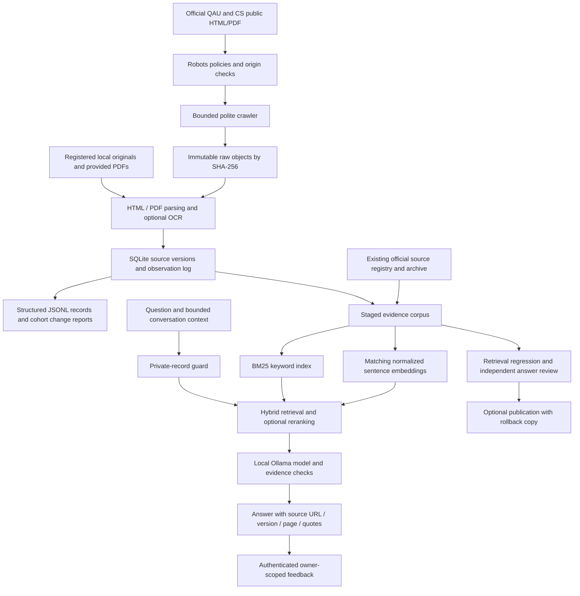

# QAU CS knowledge pipeline

This implements the ingestion, provenance, refresh, feedback and evaluation gaps
in the engineering brief on top of the existing FastAPI RAG application. It
retains BM25, sentence-transformer vectors, reciprocal-rank fusion, optional
reranking, Ollama generation, checked quotes and conversation history. It does
not require an additional search service for the current corpus size.

For the full question-to-answer execution path, current configuration, prompts,
and observed answer-quality limitations, see [the implemented chatbot
architecture](CHATBOT_ARCHITECTURE.md).

## Architecture



## Install and populate the archive

From the repository root:

```sh
backend/.venv/bin/python -m pip install -r backend/requirements.txt

# Import the registered HTML/PDF originals without contacting the university.
backend/.venv/bin/python backend/scripts/import_source_archive.py

# Re-run extraction after parser updates; original bytes and old outputs remain.
backend/.venv/bin/python backend/scripts/reprocess_source_archive.py

# An unregistered local PDF stays explicitly unverified.
backend/.venv/bin/python backend/scripts/import_source_archive.py \
  --provided-pdf academic-data/bs/example.pdf

# Discover official HTML and PDF links. Defaults: 300 pages, depth 10, 15 minutes.
backend/.venv/bin/python backend/scripts/crawl_sources.py

# A smaller focused run:
backend/.venv/bin/python backend/scripts/crawl_sources.py \
  --seed https://cs.qau.edu.pk/ --max-pages 50 --max-seconds 180
```

The crawler identifies itself as `QAU-CSBot/1.0`, checks robots before document
requests and checks each redirect before following it. It permits only the
explicit QAU main/CS hosts plus operator-approved QAU subdomains supplied with
`--allow-host`, upgrades discovered HTTP links to HTTPS, strips
fragments, preserves path case and meaningful query strings, limits query
variants and rejects credentials, unusual ports and obvious action links.
There are no logins, cookies supplied by the operator or private portal access.

The default interval is one second per origin. `Crawl-delay` and `Request-rate`
can increase it; HTTP 429/503 responses honor `Retry-After`. Robots timeouts,
server errors and 401/403 block that origin. Only 404/410 are treated as absence
of a policy. Robots redirects are also confined to approved origins. Wildcards
and rule precedence use [Protego](https://github.com/scrapy/protego), the parser
used by Scrapy. The status handling follows a conservative application of
[RFC 9309](https://www.rfc-editor.org/rfc/rfc9309.html).

ETag/Last-Modified validators avoid redownloading unchanged resources; 304
responses still follow archived links. Timeouts, unsupported formats, excessive
downloads and parsing failures are audited. Original bytes from parsing failures
are quarantined. A run never deletes an old source because a URL fails or returns
404. Limits and pending links appear in the run report: a bounded link crawl
does not prove that every public document was discovered.

The old `scrape_cs_website.py` entry point and compatibility class now delegate
to this implementation. Its legacy JSON exports are optional; they are not the
source-version catalogue.

## Stored data and interpretation

The ignored runtime directory `academic-data/crawl-archive/` contains:

| Artifact | Purpose |
|---|---|
| `objects/<prefix>/<sha256>.html` or `.pdf` | Original downloaded/imported bytes |
| `parsed/<version_id>.json` | Immutable extraction, title, metadata, pages, links, records and warnings |
| `catalogue.sqlite3` | Versions, latest resource observations, validators and append-only crawl observations |
| `robots/*.txt` | Policy responses used by crawls |
| `runs/<run_id>.json` | Status counts, errors, limits and pending-link count |
| `changes/<previous>-<new>.json` | Bounded text diff, metadata differences and course-field differences |
| `structured_records.jsonl` | Current extraction for each URL/cohort, with version/checksum provenance |
| `cohort_changes.json` | Course changes between comparable cohort documents, including distinct URLs |
| `quarantine/*.raw` | Downloaded bytes that could not safely become evidence |

A version identifies URL, raw SHA-256 and parsed content. Reprocessing with a
different parser or OCR result creates a distinct extraction version. Repeated
unchanged observations do not create duplicate versions. A rollback to earlier
bytes becomes the latest observation without erasing either version.

Effective term, publication date, HTTP Last-Modified and observation time are
separate concepts. Body dates are not automatically effective dates. Ambiguous
applicability stays unknown. Imports preserve the registry's original capture
date; importing an old PDF today does not make it current.

Course extraction recognizes explicit HTML table headers and supported digital
PDF code/title/category/credit layouts. For the supplied 2025 side-by-side
scheme, semester headings map the two columns separately. `3+1` and `4(3+1)`
retain lecture/lab components. Unknown semesters, credits and prerequisites
stay null. Prerequisite AND/OR wording remains in `prerequisites_raw`; course
sequencing is never converted into a registration rule. Ambiguous table rows
remain auditable raw records. PDF layout records require review.

Faculty contact records contain only explicitly published email text; unknown
names remain null. Policy/calendar items preserve the published descriptions
and date mentions without inventing effective dates. Structured records include
page, exact quote and line numbers **within normalized extracted text**. These
are not visual PDF line numbers. Chat citations use pages and checked quotes,
plus `source_version_id` and `source_sha256` for archived versions.

All crawl/import outputs remain `archived`; supplied PDFs remain
`provided_unverified`. Acquisition never approves a fact or writes operational
course/timetable records into PostgreSQL. Course/cohort differences are review
flags, not automatic supersession decisions. A scanned scheme with no extracted
courses cannot establish that its courses were removed.

## Scanned documents

Digital extraction uses the existing pypdf dependency. Empty or corrupt pages
are reported. To enable optional OCR:

```sh
backend/.venv/bin/python -m pip install -r backend/requirements-ocr.txt
# Install Tesseract and English language data using your host package manager.
backend/.venv/bin/python backend/scripts/import_source_archive.py --ocr
backend/.venv/bin/python backend/scripts/crawl_sources.py --ocr
backend/.venv/bin/python backend/scripts/refresh_knowledge.py --offline --semantic --ocr
```

OCR uses the installed Tesseract through
[PyMuPDF's OCR API](https://pymupdf.readthedocs.io/en/latest/page.html#Page.get_textpage_ocr).
It does not download an engine or language model. PyMuPDF has AGPL/commercial
licensing, so this dependency is optional. English OCR is configured; Urdu
scans need suitable language data and separate validation. OCR and complex
multi-column extraction require human review before operational use. PyMuPDF
was installed in the project environment, and the existing English Tesseract
installation successfully extracted the scanned 2021 scheme. That test verifies
extraction, not the academic correctness of every recognized cell. Chat notices
identify OCR-derived evidence. Add `--ocr` to a refresh job to enable this path.

## Stage, evaluate, publish and roll back

```sh
# Weekly workflow: crawl, stage corpus + matching vectors, run development checks.
backend/.venv/bin/python backend/scripts/refresh_knowledge.py --semantic --resume-pending

# Offline rebuild from registered originals and existing archive.
backend/.venv/bin/python backend/scripts/refresh_knowledge.py --offline --semantic

# Explicit publication after inspecting sources, changes and evaluation.
backend/.venv/bin/python backend/scripts/refresh_knowledge.py --offline --semantic --publish
```

New snapshots and their reports are under
`backend/data/rag/snapshots/<run_id>/`. One refresh runs at a time. Staging is the
default and never replaces the active corpus. The publication command requires
at least 25 regression questions and default evidence hit rate >=0.90. This
development gate does not certify factual answer accuracy or department approval.
The original lexical-only configuration scores below that threshold. Use the
matching cached semantic model. Publication now also requires every included
source version to have administrator approval. New extractions stay pending;
a newer pending observation does not displace a previously approved version.

The development fee questions explicitly request Fall 2025 so a newly crawled
Fall 2026 table cannot silently become their expected answer. Source alternatives
also cover the department's current clean URLs and published wording. The newer
academics page now explicitly supplies an MS Data Science duration; the older
programme page alone did not. These are maintained development labels, not an
independent held-out benchmark.

`--allow-download` explicitly permits an uncached embedding model download.
Chat requests retain their existing local-model-only configuration. Corpus
publication happens after matching embeddings are generated successfully. Dense artifacts are
replaced before the corpus; readers with mismatched fingerprints visibly use
BM25 until the bundle matches. A `previous.*` bundle is retained in the snapshot
directory. To restore it, call `publish_snapshot(previous, live, another_backup)`
from `scripts.refresh_knowledge` using the same virtual environment. Stop the
refresh timer while performing an operator rollback.

The source archive retains older cohorts. Search uses the latest observation
for each URL/explicit cohort and does not reintroduce superseded copies from the
legacy scrape. It retains differently dated schemes, rather than assuming the
latest admission batch applies to every student. Incomplete evidence can still
require a programme/batch clarification.

For scheduling, adapt `deploy/systemd/qau-knowledge-refresh.service` to the
installation path and service account. Pre-create the two writable runtime
directories with ownership for that account, install the service/timer in
`/etc/systemd/system`, then enable the timer. It stages weekly on Sunday at
03:00 Asia/Karachi with up to 15 minutes of jitter. It does not publish on a timer
unless the operator explicitly adds `--publish`. Run status is available through
systemd/journald and the snapshot refresh reports. No Linux timer was installed here. On this macOS installation, the per-user
`pk.edu.qau.cs.knowledge-refresh` LaunchAgent is installed for Sunday 03:00 PKT.
It crawls incrementally, resumes previously unvisited links with `--resume-pending`,
stages and evaluates; it never publishes. Logs are in
`.runtime/refresh/`. Recreate it with
`backend/.venv/bin/python backend/scripts/configure_refresh_schedule.py --install`.

## Embeddings and generation

The normal local application now uses cached `intfloat/multilingual-e5-small`
and local Ollama `qwen3:8b`. A model-only migration rebuilt vectors for the exact
same 633 active corpus records; academic corpus bytes did not change. The prior
MiniLM bundle is retained under `backend/data/rag/snapshots/11111111111141118111111111111111/previous.*`.
The separate expanded 2,288-passage candidate remains a review preview on port
8001; newly acquired rules were not published automatically.
To evaluate a multilingual encoder, set `EMBEDDING_MODEL` to a supported model
such as `sentence-transformers/LaBSE`, rebuild with `--semantic --allow-download`,
and review English/Roman Urdu quality before publication. The
[Sentence Transformers model catalogue](https://www.sbert.net/docs/sentence_transformer/pretrained_models.html)
distinguishes multilingual models from the general English MiniLM family.
Multilingual coverage alone does not demonstrate Roman Urdu retrieval accuracy.

The authoritative system prompt remains `app/response/grounded.py:SYSTEM`,
alongside its structured output schema and application checks. It separates
untrusted document/history text from instructions, preserves programme/cohort
scope, asks for exact supporting quotes, and abstains on missing evidence. The
application checks source IDs, quotes and numerical support; the model's
entailment review is still fallible. Private-record requests now bypass retrieval
and generation through `app/response/privacy.py`. Public faculty directory
contacts and general GPA/attendance policies remain eligible for sourced answers.

The brief's Llama suggestion is an interchangeable deployment choice. Meta's
[Llama 3.2 model card](https://huggingface.co/meta-llama/Llama-3.2-3B-Instruct)
describes a community-licensed, open-weight model; that does not make inference
hardware, hosting or all deployments cost-free. Urdu/Roman Urdu quality and
entailment reliability must be measured for whichever generator is selected.

## Evaluation and review

`backend/evaluation/production_questions.json` contains 150 **pending review
candidates** across ten topics: admissions, curriculum, prerequisites, fees,
faculty/research, timetable/exams, academic policies, programmes, versioning/
grounding, and private/unknown questions. There are 100 English and 50 Roman Urdu
questions. This is neither independent ground truth nor a passed evaluation.

For each candidate, reviewers must confirm expected behavior, write a reference
answer, label relevant official sources with exact quotes and optional version
IDs, and record reviewer/date before setting `review_status=approved`. Current,
unknown and unavailable information may require abstention or clarification;
candidate behavior labels can be corrected during review. Keep independent
held-out questions separate from the existing 28-case development set.

```json
{
  "id": "example-reviewed-case",
  "question": "A student question",
  "category": "curriculum",
  "language": "english",
  "expected_behavior": "answer",
  "review_status": "approved",
  "reviewer": "Department reviewer identifier",
  "reviewed_at": "2026-10-10",
  "reference_answer": "The department-reviewed answer",
  "relevant_sources": [{
    "source_url": "https://cs.qau.edu.pk/doc/example.pdf",
    "source_version_id": "optional-exact-archived-version-id",
    "quote": "An exact supporting quote from the labelled source"
  }]
}
```

```sh
# Approved source-labelled cases; exit 2 when there are no approved cases.
backend/.venv/bin/python backend/scripts/evaluate_pipeline.py

# Diagnostic retrieval over all candidates, without claiming quality scores.
backend/.venv/bin/python backend/scripts/evaluate_pipeline.py \
  --include-unreviewed --output backend/evaluation/pipeline_diagnostics.json

# Explicitly call the configured local LLM and save answers for review.
backend/.venv/bin/python backend/scripts/evaluate_pipeline.py --live

# Existing development regression, reported separately.
backend/.venv/bin/python backend/scripts/evaluate_rag.py

# Optional real-engine checks, separate from the fast backend suite.
cd backend
RUN_OCR_TESTS=1 .venv/bin/python -m pytest -q \
  tests/test_ingestion.py::test_real_scanned_2021_scheme_uses_installed_ocr
RUN_RAG_DB_TESTS=1 .venv/bin/python -m pytest -q tests/test_feedback_postgres.py
```

The reviewed evaluator reports source-level precision/recall/MRR within top-K
retrieved passages, deduplicating document versions and matching supporting
quotes. ROUGE-L F1 measures wording overlap when a reviewed reference exists.
Citation checks validate retrieved IDs/URLs/versions and exact quotes. Neither
measure proves factual entailment. Human factual accuracy, groundedness,
appropriate abstention and clarity fields remain null until rated. Pending
examples cannot inflate quality scores. Review at least 50 live answers and
complete independent source labels for >=150 examples before using the brief's
production accuracy targets as release criteria.

## Feedback, logs and migration

The existing chat handler logs response engine, grounding status, source count
and latency without guest transcript persistence. Signed-in history retains
ownership checks and source metadata. Feedback stores one removable vote per
saved assistant message, with a fixed reason code and no extra transcript or
free-text personal data.

Apply the additive migration to an existing PostgreSQL installation:

```sh
backend/.venv/bin/python backend/scripts/upgrade_rag_database.py --apply
```

Fresh Compose installations include `database/pipeline_feedback.sql`. Existing
volumes must receive the migration explicitly; recreating a volume is unnecessary.
The endpoint returns 503 if the optional feedback schema is unavailable.
The migration was applied to the local development database and checked with a
PostgreSQL test whose synthetic rows were rolled back.

| Endpoint | Access |
|---|---|
| `PUT /api/v1/feedback/{assistant_message_id}` | Signed-in owner; body `{"rating": -1, "reason": "outdated"}` |
| `DELETE /api/v1/feedback/{assistant_message_id}` | Owner deletes their vote |
| `GET /api/v1/feedback` | Administrator receives vote counts by rating/reason |

Reasons are `helpful`, `incorrect`, `outdated`, `missing_information` and `unclear`.
Message IDs come from the authenticated history API. The chat UI includes owner feedback controls, and administrators can inspect
aggregates in **Ingestion Review**. That screen also exposes failures, conflicts,
extracted records, original downloads, exact-version approval and controlled
snapshot publication. Deleting a saved message or user cascades to its vote. Configure existing
history retention/consent practices before public operation; this change does
not enable access to student records or add model-training use of transcripts.

## Verification and remaining release work

The implementation was checked with network-free crawl/version/access-control
tests, the real archived 2025 PDF, an offline import/rebuild, and a bounded live
official-source crawl. Development retrieval and actual answer accuracy are
reported separately. See `backend/evaluation/pipeline_implementation_report.json`
for the measured run and its limits.

Department review of structured values and changes, a labelled independent
150-question set, review of OCR-extracted values, current operational policies, native
language evaluation, sustained production load testing, production HTTPS, off-machine backups
and an independent operator restoration drill remain deployment work. A missing approved prerequisite
matrix or FYP SOP cannot be supplied by code or inferred from a semester plan.


## Additional executable verification

The crawler now inspects robots-advertised and conventional sitemaps and supports
explicit additional QAU hosts through `--allow-host`. HTML, PDF, DOCX and selected
university text originals are inventoried by `import_workspace_documents.py`;
compiled local packs remain unverified. The measured crawl report is generated by:

```sh
backend/.venv/bin/python backend/scripts/report_crawl_coverage.py
backend/.venv/bin/python backend/scripts/import_workspace_documents.py --ocr
```

`backend/evaluation/source_checked_questions.json` contains 162 AI source-checked
engineering cases, with exact official URLs, quotes and available version hashes,
in English, Urdu and Roman Urdu. It supplements the 150 pending independent-review
candidates; it does not approve them. Fact groups separate development and held-out
splits, but inspected failures are regression evidence, not a pristine independent
benchmark. Some policies return the original published English wording with a
localized introduction; native-language quality still needs human assessment.

```sh
# Real inference and citations against the expanded review preview.
backend/.venv/bin/python backend/scripts/evaluate_live_chat.py \
  --base-url http://127.0.0.1:8001 \
  --corpus backend/data/rag/production-candidate/corpus.jsonl \
  --questions backend/evaluation/source_checked_questions.json \
  --output backend/evaluation/live_source_checked_report.json

# Real browser tests with private temporary accounts and fixture cleanup.
PLAYWRIGHT_BASE_URL=http://127.0.0.1:5174 \
  backend/.venv/bin/python backend/scripts/run_browser_checks.py

# Private backup: immutable objects, a consistent SQLite copy, live vectors,
# corpus and optional PostgreSQL custom dump. All entries are checksum-verified.
backend/.venv/bin/python backend/scripts/backup_pipeline.py --database
```

Backups are under ignored `.runtime/backups/`, with mode 0600. Verify a chosen
backup using `backup_pipeline.py --verify <backup.tar.gz>`. Restore verified files
to a new private directory for inspection first; never unpack over a running
installation. The local restoration check also restored PostgreSQL into a temporary private
cluster with TCP disabled and checked the restored archive and matching vectors.
An operator restoration drill on separate infrastructure remains required. For a library rollback, stop refreshes,
restore the retained previous bundle with `publish_snapshot`, restore its matching
embedding-model configuration, then restart and check `/api/v1/health/ready`.

The readiness endpoint checks the corpus, matching semantic index, database,
history schema and installed Ollama model. Chat requests have bounded concurrency,
a 65-second API deadline and bounded history; generation has a 45-second budget.
The frontend displays timeouts and preserves owner-scoped sessions and citations.
Production password recovery never returns a reset token; an approved delivery
provider remains required before enabling public account recovery.

Measured comparisons, real answers, failures, demonstrations and release limits
are recorded in `backend/evaluation/production_implementation_audit.json`. These
artifacts distinguish reference-pattern success, citation provenance and human
factual accuracy. No departmental approval or independent human score is inferred.

Run the executable recovery and runtime checks with:

```sh
backend/.venv/bin/python backend/scripts/check_backup_restore.py \
  --backup .runtime/backups/<chosen-backup>.tar.gz --postgres \
  --output backend/evaluation/backup_restore_report.json
backend/.venv/bin/python backend/scripts/verify_runtime.py \
  --output backend/evaluation/runtime_verification.json
```

The generation comparison retains Qwen3 8B: six identical gold-evidence prompts
passed its provenance/reference checks, versus four for Llama 3.2 3B. This small
comparison supports the local choice but does not establish broad model superiority.
E5-small improved development Recall@5 from 0.870 to 0.919 over English MiniLM.
The optional multilingual reranker reached 0.935 but reduced MRR and increased
median retrieval latency from 82 ms to 684 ms; it remains disabled by default.

The latest all-workspace staging run is
`92c5934ff2b748399798af417c832136`: 2,348 passages across 255 documents,
with a 0.96 development evidence hit rate at six passages. It remains unpublished.
Its `crawl_http_coverage.json` and the top-level crawl report count only actual HTTP
crawl runs; offline reprocessing cannot erase a failed download. Parser version 4
recognizes explicit opening timetable headings even when PDF metadata is an opaque
Word filename. An unknown date never establishes a requested timetable year.

Development labels were updated after inspecting the new OSFA scholarship page
and Fall 2026 timetable. The department-history expectation still lacks matching
current evidence. These label changes do not validate an independent benchmark.
The final browser suite passed after staging finished and the encoder warmed;
a concurrent-refresh run separately recorded the expected publication lock and
a 5.3-second cold fee lookup. Cold starts and sustained load require deployment
capacity planning.

See [28 actual demonstration answers](CHATBOT_DEMONSTRATION.md), with the original
normal-app citations and explicit fallbacks. The expanded review preview remains
on port 5174 / API 8001 and uses the frozen 2,288-passage evaluation snapshot,
rather than silently replacing the normal app or its academic facts.

Measured final checks on 2026-10-10: 251 backend tests passed (5 optional skips),
10 frontend unit tests passed, all 9 real browser checks passed, and the production
frontend build and Compose configuration check passed. The 162-case real HTTP
run matched 159 reference patterns, had no HTTP errors, and returned valid
citations for every official-answer case: all 174 citations passed provenance
checks. Median latency was 93 ms; p95 was 15.8 seconds. Most cases used
deterministic source lookups, so these numbers are not LLM-only latency.
Independent human factual accuracy and entailment remain unmeasured.

The final backup contains 1,191 checksummed files. An isolated restoration verified
576 source versions, 633 live corpus records with matching vectors, and all 40
public PostgreSQL tables. HTTP crawl coverage is 227 processed, 21 failed,
4 blocked and 1,384 pending out of 1,636 discovered resources. All 21 supported
workspace originals were imported or linked to their registered originals;
13 retain official registry provenance and 8 remain supplied/unverified.
